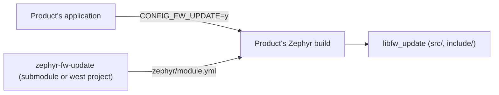

# Project Overview

`zephyr-fw-update` is a Zephyr module for firmware update over SMP (mcumgr) through MCUboot: a new
image is received on the same serial port as the product's own commands, test-run, and then
confirmed or reverted. It knows no product. A product adds it to its build, as a git submodule or a
west project, and enables it with `CONFIG_FW_UPDATE=y`.

This file is the starting point for anyone, person or AI, who opens the repository without earlier
context: what the module is for, what is decided, what is open, and how to work here.

### Goals

- One firmware update function that several products can use, delivered to customers as a module.
- Product-neutral: nothing in the module depends on a particular product, board or customer.
  non-secret products may be referred to as examples in the documentation.
- Easy to add to a product: a git submodule or a west project, and one Kconfig option.
- A product uses it fully, partly or not at all, through Kconfig options and a small C API.

### Status

**Skeleton.** The build integration, a smoke test, CI and the documentation exist. The C API is
being designed, so `include/fw_update/fw_update.h` declares no functions and `src/fw_update.c` only
registers the log module. Nothing is usable by a product yet.

### Planned scope (agreed, not implemented)

These responsibilities are planned for the module. The product keeps its own drivers and application
logic and talks to the module through the C API.

| In the module | In the product |
|---|---|
| The SMP transport on the product's serial port, shared with the product's text commands | Its serial driver separates SMP frames from text and passes the frames to the module |
| Writing SMP responses through a write function the product gives at startup | Writing the responses on its serial port |
| A reset hook with a handshake: "restart requested", then "app ready", with a time limit | An orderly shutdown before the restart, then "ready" |
| Checking that a received image is for the right board (board target in a TLV), erasing it if not | – |
| Kconfig defaults for mcumgr (progressive erase, hash, size checks) | – |
| Confirm or reset based on the self-test result the product reports; rejecting confirm while the self-test runs | The self-test, and reporting its result |
| Reading MCUboot's state: running version, confirmed or not, the image in the second slot | Showing it, if the product wants to |

MCUboot runs in **swap using offset** on products where the image fits in the internal flash. The
new image is written one sector into the second slot; after a swap, the previous image is at the
start of that slot, so whatever reads the header there must handle both places. RAM-load products
are not part of the first version.

### Decisions so far

| Decision | Choice |
|---|---|
| Where the module lives | Its own repository from the start, not inside a product, so it can be delivered on its own |
| How a product gets it | A git submodule (with `ZEPHYR_EXTRA_MODULES`) or a west project; both are documented in `docs/setup.md` |
| Zephyr | The module brings no Zephyr; it is built with the product's. Development uses Zephyr v4.4.2 |
| Tests | Ztest on `native_sim` (32-bit, like the boards) with the host's gcc, run by Twister |
| Language of the repository | English, since the module goes to other customers |
| Visibility and review | Public repository; `main` only through approved pull requests (see Agent Guardrails) |

### Open decisions

- The C API: functions, types and their names.
- Code style and `.clang-format`: Zephyr's style or another one.
- The license (there is none yet).
- Versions and tags: when a product-facing version is tagged.
- The word *test* (MCUboot's and mcumgr's) or *trial* for the state between swap and confirm.
- The size of the buffer for SMP responses, and that mcumgr finds the previous image at the start of
  the second slot after a swap.

## Repository Structure

- `zephyr/module.yml` – tells Zephyr where the module's CMake and Kconfig are (module name
  `fw_update`).
- `Kconfig` – `CONFIG_FW_UPDATE` and the module's log level.
- `CMakeLists.txt` – builds `src/` into the application and adds `include/` when
  `CONFIG_FW_UPDATE=y`.
- `include/fw_update/` – the public C API (`fw_update.h`, empty for now).
- `src/` – the implementation (`fw_update.c`, only the log module for now).
- `tests/` – Ztest apps, one folder each, run by Twister on `native_sim` (`tests/smoke/`).
- `docs/` – setup in a product, development, and contributing.
- `west.yml`, `tools/` – the west workspace for developing the module on its own; not used by a
  product.
- `.github/workflows/` – CI.
- `AGENTS.md` (this file), `CLAUDE.md` – context for people and AI tools; `CLAUDE.md` only loads
  this file.

Not committed: `.venv/`, `.west/`, `deps/` (fetched by `tools/setup.sh`), `build*/`,
`twister-out*/`, `flash.bin`.

## Build & Development Commands

Set up the workspace (first time only) and activate it (every new terminal):

```bash
tools/setup.sh
source tools/env.sh
```

Build and run all tests:

```bash
west twister -T tests -p native_sim
```

Build and run one test app by hand (it writes native_sim's simulated flash to `flash.bin`, which is
ignored):

```bash
west build -p always -b native_sim -s tests/smoke -d build/smoke
build/smoke/zephyr/zephyr.exe
```

Host packages: `git`, `cmake`, `python3` with `venv`, `gcc` and `gcc-multilib` (native_sim is
32-bit). CI also installs `ninja-build`, `gperf` and `device-tree-compiler`.

> TODO: lint and format commands (no `.clang-format` or format check yet).

> TODO: building for real boards (needs the Zephyr SDK; `tools/env.sh` uses the host's gcc only).

> TODO: release / tagging procedure (no versions or tags yet).

## Code Style & Conventions

- Language: C for the module; the header has `extern "C"` guards so C++ products can include it.
- Names: module `fw_update`, Kconfig symbols `FW_UPDATE_*`, public headers under
  `include/fw_update/`, log module `fw_update`.
- Kconfig files are indented with tabs, as in Zephyr.
- The module must stay product-neutral: no product, board or customer names in code, docs or
  commits.
- Commits: small and reviewable one at a time; summary in the imperative, under 72 characters, then
  a blank line and the why if it is not obvious:

  ```
  Add the reset hook

  Why the change is needed, if it is not obvious.
  ```

> TODO: formatting rules and the `.clang-format` (see Open decisions).

> TODO: naming rules for the C API's functions and types.

## Architecture Notes



- The module has no Zephyr of its own. It is built with the product's Zephyr: Zephyr finds it
  through `zephyr/module.yml` (west project) or `ZEPHYR_EXTRA_MODULES` (submodule), reads `Kconfig`,
  and builds `CMakeLists.txt` when `CONFIG_FW_UPDATE=y`.
- The repository's own `west.yml` (Zephyr v4.4.2, `mcuboot`, `zcbor`) exists only to build and test
  the module without a product.
- Planned data flow (see Planned scope): the product passes SMP frames from its serial port to the
  module; the module receives the image through mcumgr into the second slot and has MCUboot test-run
  it after a restart; the product reports its self-test result, and the module confirms the image or
  resets so that MCUboot reverts it. None of this is implemented yet.

## Testing Strategy

- Framework: Zephyr's Ztest, one app per folder in `tests/`, run by Twister on `native_sim` (Zephyr
  built as a Linux program) with the host's gcc. No board or Zephyr SDK is needed.
- `tests/smoke/`: builds an app with `CONFIG_FW_UPDATE=y` and checks that the module is enabled. The
  build fails if Zephyr does not find the module (`undefined symbol FW_UPDATE`).
- Locally: `west twister -T tests -p native_sim`.
- CI (`.github/workflows/ci.yml`): on every push, `tools/setup.sh`, then `west twister -T tests -p
  native_sim --outdir twister-out --inline-logs`; the report `twister-out/twister.xml` is uploaded
  as an artifact (kept 3 days).
- CI runs on push only, so it tests the branch, not its merge with `main`.
- New behaviour gets a test in `tests/`.

> TODO: tests on real boards (hardware-in-the-loop), and tests that build for board targets.

## Security & Compliance

- No secrets in the repository, and none are needed to build or test.
- License: **none yet**, so all rights are reserved. The repository is public, but no one may use
  the code until a `LICENSE` is added.

> TODO: the license.

> TODO: signing keys for MCUboot images (where they live and who holds them) once signing is added.

> TODO: dependency scanning (none set up; dependencies are pinned in `west.yml`).

## Agent Guardrails

- **Keep this file current.** Whenever a change affects what this file describes (structure,
  commands, decisions, status, open questions, conventions), update `AGENTS.md` in the same pull
  request. Keep it short: replace outdated text instead of adding history, and put details in
  `docs/`.
- Never push to `main`. A ruleset on the default branch requires a pull request approved by someone
  other than the last pusher, with all comment threads resolved; force-push and deletion of `main`
  are blocked.
- One change per branch and pull request; merge with "Create a merge commit".
- Keep a pushed branch up to date with `git merge origin/main`, not rebase or force-push.
- Never commit or edit generated or fetched files: `.venv/`, `.west/`, `deps/`, `build*/`,
  `twister-out*/`, `flash.bin`.
- Keep the module product-neutral: no product, board or customer names.
- Do not add functions to the public C API without agreement in a reviewed pull request: the API is
  still being designed.
- Do not invent facts: if something is not in the repository or was not tested, say so.
- Run `west twister -T tests -p native_sim` before pushing.

## Extensibility Hooks

| Hook | Where | Effect |
|---|---|---|
| `CONFIG_FW_UPDATE` | `Kconfig` | Builds the module into the application |
| `CONFIG_FW_UPDATE_LOG_LEVEL` | `Kconfig` (Zephyr's log template) | The module's log level |
| `ZEPHYR_EXTRA_MODULES` | The product's `CMakeLists.txt` | How a product finds the module as a git submodule |
| `FW_UPDATE_ROOT` | `tools/env.sh` | The repository root, set when the workspace is activated |
| `ZEPHYR_BASE` | `tools/env.sh` | `deps/zephyr` in the module's own workspace |
| `ZEPHYR_TOOLCHAIN_VARIANT=host` | `tools/env.sh` | Builds with the host's gcc (native_sim only) |

> TODO: the module's own Kconfig options and C API hooks, once designed.

## Further Reading

- [README.md](README.md) – what the module is, and the folder layout.
- [docs/setup.md](docs/setup.md) – adding the module to a product.
- [docs/development.md](docs/development.md) – building and testing the module on its own.
- [docs/contributing.md](docs/contributing.md) – branches, pull requests and review.
