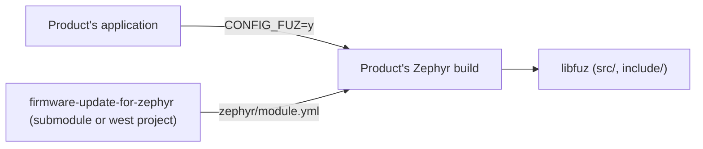

# Project Overview

`firmware-update-for-zephyr` is a Zephyr module for firmware update over SMP (mcumgr) through
MCUboot: a new image is received on the same serial port as the product's own commands, test-run,
and then confirmed or reverted. It knows no product. A product adds it to its build, as a git
submodule or a west project, and enables it with `CONFIG_FUZ=y`.

This file is for AI tools (and people) that open the repository without earlier context: how to
work here, and where the rest is documented.

Goals and status are in [README.md](README.md). The decisions so far, the planned scope and the
open decisions are in [docs/decisions.md](docs/decisions.md): read it before changing anything. How
we work (branches, pull requests, review, commits, tests) is in
[docs/contributing.md](docs/contributing.md).

## Repository Structure

- `zephyr/module.yml` – tells Zephyr where the module's CMake and Kconfig are (module name
  `fuz`).
- `Kconfig` – `CONFIG_FUZ`, who confirms a new image, the time limits and the module's log level,
  and fuz's default for an mcumgr option.
- `CMakeLists.txt` – builds `src/` into the application and adds `include/` when
  `CONFIG_FUZ=y`.
- `include/fuz/` – the public C API (`fuz.h`).
- `src/` – the implementation (`fuz.c`: `fuz_init()`, `fuz_is_confirmed()` and `fuz_confirm()`;
  the other functions return "not implemented" for now).
- `tests/` – Ztest apps, one folder each, run by Twister on `native_sim` (`tests/api/`).
- `docs/` – setup in a product, development, contributing, decisions, and choosing the SMP buffer
  size.
- `west.yml`, `tools/` – the west workspace for developing the module on its own; not used by a
  product.
- `.github/workflows/` – CI.
- `AGENTS.md` (this file), `CLAUDE.md` – context for people and AI tools; `CLAUDE.md` only loads
  this file.

Not committed: `.venv/`, `.west/`, `deps/` (fetched by `tools/setup.sh`), `build*/`,
`twister-out*/`, `flash.bin`.

## Build & Development Commands

Set up the workspace (first time only) and activate it (every new terminal):

```bash
tools/setup.sh
source tools/env.sh
```

Build and run all tests:

```bash
west twister -T tests -p native_sim
```

Build and run one test app by hand (it writes native_sim's simulated flash to `flash.bin`, which is
ignored):

```bash
west build -p always -b native_sim -s tests/api -d build/api
build/api/zephyr/zephyr.exe
```

`tools/env.sh` sets the environment for the module's own workspace (not used by a product):

- `FUZ_ROOT` – the repository root.
- `ZEPHYR_BASE` – `deps/zephyr`.
- `ZEPHYR_TOOLCHAIN_VARIANT=host` – builds with the host's gcc (native_sim only).

Host packages: `git`, `cmake`, `python3` with `venv`, `gcc` and `gcc-multilib` (native_sim is
32-bit). CI also installs `ninja-build`, `gperf` and `device-tree-compiler`.

Format the C code before committing with `tools/clang-format/fix.sh` (see `docs/development.md`).

> TODO: building for real boards (needs the Zephyr SDK; `tools/env.sh` uses the host's gcc only).

> TODO: release / tagging procedure (no versions or tags yet).

## Code Style & Conventions

- Language: C for the module; the header has `extern "C"` guards so C++ products can include it.
- Names: module `fuz` (Firmware Update for Zephyr), Kconfig symbols `FUZ_*`, public headers under
  `include/fuz/`, C functions and types `fuz_*`, log module `fuz`. The repository is
  `firmware-update-for-zephyr`.
- Kconfig files are indented with tabs, as in Zephyr.
- C code: Zephyr's style, from `.clang-format` (a copy of Zephyr v4.4.2's), checked in CI.
- Commits: see `docs/contributing.md`.

- The C API (`include/fuz/fuz.h`): functions usually return 0 or a negative errno. Two kinds of
  functions return something else: `bool` for yes/no answers that cannot fail, and `int` with 1, 0
  or a negative errno for reads that can. Doc comments in Zephyr's style: `@retval` for each value
  a function returns, `@return` for a one-sentence answer (a `bool`, or a callback whose errno the
  product chooses), `@param[out]` for out-parameters, `@p` for a parameter in the text; `(void)`
  for functions without arguments.

## Architecture Notes



- The module has no Zephyr of its own. It is built with the product's Zephyr: Zephyr finds it
  through `zephyr/module.yml` (west project) or `ZEPHYR_EXTRA_MODULES` (submodule), reads `Kconfig`,
  and builds `CMakeLists.txt` when `CONFIG_FUZ=y`.
- The repository's own `west.yml` (Zephyr v4.4.2, `mcuboot`, `zcbor`) exists only to build and test
  the module without a product.
- Planned data flow (see the planned scope in `docs/decisions.md`): the product passes SMP frames
  from its serial port to the module; the module receives the image through mcumgr into the second
  slot and has MCUboot test-run it after a restart; the product reports its self-test result, and
  the module confirms the image or resets so that MCUboot reverts it. Implemented so far: the setup
  (`fuz_init()`), reading whether the image is confirmed, confirming it (`fuz_confirm()`),
  confirming it at startup (`CONFIG_FUZ_CONFIRM_AT_BOOT`, a `SYS_INIT` in `src/fuz.c`), reverting it
  with a restart (`fuz_revert()`), reading the running image's version from its header
  (`fuz_get_running_version()`), and the Kconfig default that stops the client from confirming
  slot 1 before it has run.

## Testing Strategy

- Framework: Zephyr's Ztest, one app per folder in `tests/`, run by Twister on `native_sim` (Zephyr
  built as a Linux program) with the host's gcc. No board or Zephyr SDK is needed.
- `tests/api/`: the C API on `native_sim`, once per confirm mode and with the time limits set
  (`testcase.yaml`), so each Kconfig combination builds. The MCUboot functions and `sys_reboot()`
  fuz calls are FFF fakes (`src/fakes.h`, `src/fakes.c`; native_sim has no MCUboot, and the
  `sys_reboot()` fake `longjmp()`s back to the test, since `sys_reboot()` never returns), reset
  before every test by a `ZTEST_RULE` in `src/fakes.c` (the calls fuz made at startup are saved
  there first, in `startup_*_calls`); one file and one test suite per area (`src/test_api.c`,
  `src/test_confirm.c`, `src/test_revert.c`, `src/test_version.c`). A function not implemented yet
  is checked in `test_stubs`; when it is implemented, its line goes and it gets a test of its own.
  The build fails if Zephyr does not find the module (`undefined symbol FUZ`).
- CI (`.github/workflows/ci.yml`), on every push, two jobs: `format-check` runs
  `tools/clang-format/check.sh`; `tests` runs `tools/setup.sh`, then `west twister -T tests -p
  native_sim --outdir twister-out --inline-logs`, and uploads the report `twister-out/twister.xml`
  as an artifact (kept 3 days).
- Which changes need tests, and when to run them: see `docs/contributing.md`.

> TODO: tests on real boards (hardware-in-the-loop), and tests that build for board targets.

## Security & Compliance

- No secrets in the repository, and none are needed to build or test.
- License: **none yet**, so all rights are reserved. The repository is public, but no one may use
  the code until a `LICENSE` is added.

> TODO: the license.

> TODO: signing keys for MCUboot images (where they live and who holds them) once signing is added.

> TODO: dependency scanning (none set up; dependencies are pinned in `west.yml`).

## Agent Guardrails

- **Keep the documentation current, in one place.** Whenever a change affects what this file
  describes (structure, commands, conventions), update `AGENTS.md` in the same pull request;
  decisions, scope and open questions go in `docs/decisions.md`, status and goals in `README.md`,
  how we work in `docs/contributing.md`. Write each rule in one file only and link to it from the
  others. Keep it short: replace outdated text instead of adding history.
- Follow `docs/contributing.md` for branches, pull requests, commits and tests.
- Never commit or edit generated or fetched files: `.venv/`, `.west/`, `deps/`, `build*/`,
  `twister-out*/`, `flash.bin`.
- Keep the module product-neutral: no product, board or customer names in code or commits; in the
  documentation, only non-secret products, as examples.
- Do not add functions to the public C API without agreement in a reviewed pull request: the API is
  still being designed.
- Do not invent facts: if something is not in the repository or was not tested, say so.

## Extensibility Hooks

What a product can set or connect to change how the module works.

| Hook | Where | Effect |
|---|---|---|
| `CONFIG_FUZ` | `Kconfig` | Builds the module into the application |
| `CONFIG_FUZ_LOG_LEVEL` | `Kconfig` (Zephyr's log template) | The module's log level; *Default* follows `CONFIG_LOG_DEFAULT_LEVEL` (see `docs/setup.md`) |
| `CONFIG_FUZ_CONFIRM_AT_BOOT`, `_BY_PRODUCT`, `_BY_CLIENT`, `_BY_ANY` | `Kconfig` (a choice) | Who confirms a new image (see `docs/decisions.md`) |
| `CONFIG_FUZ_CONFIRM_TIMEOUT_MS` | `Kconfig` | Restart without confirm, so MCUboot reverts, if nothing confirms in time |
| `CONFIG_FUZ_RESET_READY_TIMEOUT_MS` | `Kconfig` | The product's time to get ready for a restart |
| `ZEPHYR_EXTRA_MODULES` | The product's `CMakeLists.txt` | How a product finds the module as a git submodule |

> TODO: the C API hooks (the write function given to `fuz_init()`), once implemented.

## Further Reading

- [README.md](README.md) – what the module is, and the folder layout.
- [docs/setup.md](docs/setup.md) – adding the module to a product.
- [docs/development.md](docs/development.md) – building and testing the module on its own.
- [docs/contributing.md](docs/contributing.md) – branches, pull requests, review, commits and tests.
- [docs/decisions.md](docs/decisions.md) – decisions so far, planned scope and open decisions.
- [docs/smp-buffer.md](docs/smp-buffer.md) – choosing the SMP buffer size.
